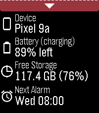
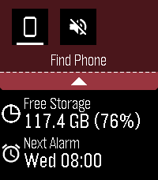

# dashboard2

<table>
  <tr>
    <td></td>
    <td></td>
  </tr>
</table>

**IMPORTANT**: Requires Android companion app!

Modern successor to Dashboard, which is largely defunct now due to background app Android policy and permissions clampdowns since 2016. Starting with minimal features, and adding more as they are deemed possible with opt-in special device access as required. The focus is on modularity, maintainability, and re-usability.

Data available:

- Device name
- Device battery level and charging status
- Device free storage space
- Next Android alarm

Toggles / features available:

- Find Phone with loud sound
- Cycle through ringer modes (requires opt-in permission, see below)

Uses PebbleKit Android 2 to retrieve information about the phone and control some toggles / features via the official Pebble Android app.

## Installation

Install the Pebble watchapp from your appstore of choice, then install the
[required Android APK](https://s3.us-east-1.amazonaws.com/public-files.chrislewis.me.uk/pebble/dashboard2-1.0.0.apk).

## Feature requests

Please see [this issue](https://github.com/C-D-Lewis/pebble-dev/issues/18) for
status of feature requests. If you think you can help implement a new feature
(new info or toggle), PRs are welcome!

## Permissions

These permissions are listed in the manifest and explained below. If you choose
not to grant them, the corresponding feature will just not work.

| Permission                                      | Feature           | Details                                               |
|-------------------------------------------------|-------------------|-------------------------------------------------------|
| `android.permission.ACCESS_NOTIFICATION_POLICY` | Cycle ringer mode | allow prompting access to notification policy / modes |

## Adding new features

To add a new piece of sync'd data:

1. Define new AppMessage key in `package.json` and `Constants.kt` (note:
   AppMessage keys start at 10000 and order matters!)
2. Add the key to the dictionary sent from Android in `handleSyncRequest()`.
3. Add the item to `AppState`.
4. Handle receiving the new key in `comm.c`.
5. Add the new data to the list (list UI TBD) in `main_window.c`.

To add a new toggle / feature:

1. Define new `ToggleType` and add to `Constants.kt`.
2. Implement the feature logic and any newly required `TOGGLE_STATE` values on
   both sides.
3. Increase the state string length and implement returning the toggle type and
   toggle state in `getToggleOrderString()`.
4. Handle the new toggle in the pull-down tray grid.

## See Also

- [Dashboard](https://apps.rebble.io/en_US/application/53ec8d840c3036447e000109)
- [PebbleKit Android 2](https://github.com/pebble-dev/PebbleKitAndroid2)

## TODO

- Status bar in details area
- Details area scrolls
